Software engineer building toward applied AI. I like typed code, measurable results, and tools that survive contact with real data.

### Now
- [BA-growth-tool](https://github.com/TirthPatel6104/BA-growth-tool) — basal-area growth regression for forestry plots. TypeScript, RGR models, charting. Real-world data with gaps, outliers and units that bite.
- Next: a Python port of the regression core with a proper eval harness, then a small LLM-assisted data-cleaning step on top. <!-- replace with your actual AI project when it exists -->

### Stack
| | |
|---|---|
| Languages | Python 3.10+ · Java · C# · TypeScript |
| AI / ML | PyTorch · scikit-learn · pandas · LLM APIs · RAG basics |
| Engineering | REST APIs · PostgreSQL · Docker · GitHub Actions · pytest |

### How I work
- Root cause before fix. Tests before refactor.
- Small modules, type hints, no clever one-liners.
- Measure it or it didn't improve.

### Targeting
Software Engineer or AI Engineer roles. Open to internships, contract, and full-time.

Contact via issues or the email on my profile.
